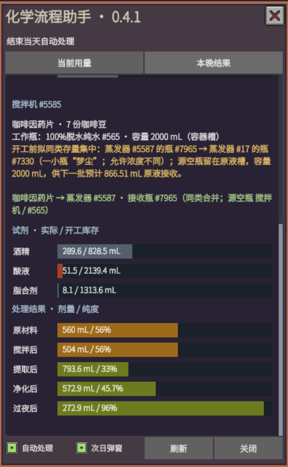
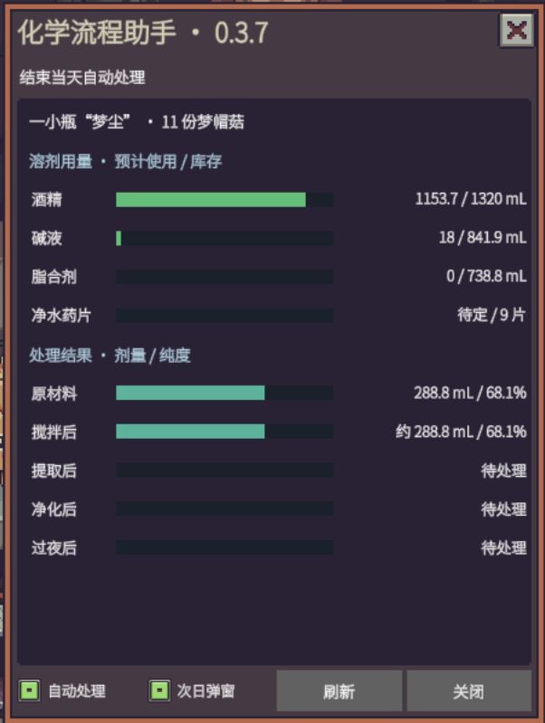

# Probably Stolen 化学流程助手

在《Probably Stolen》中安排化学加工：放好原料和设备，点击“结束当天”，助手自动逐批处理，并在次日汇总结果。使用游戏原生化学与耗料接口，蒸发仍由原生过夜流程完成。

[Steam 创意工坊订阅](https://steamcommunity.com/sharedfiles/filedetails/?id=3836818025) · [当前版本](ChemAssistPlus/VERSION) · [更新记录](ChemAssistPlus/CHANGELOG.md) · [完整使用说明](ChemAssistPlus/使用说明.txt)

## 主要功能

- **结束当天自动加工**：遍历搅拌机，按顺序执行搅拌、补料、提取、去蛋白/脂肪、两级过滤和按需净化，再送入蒸发器。每台每晚处理一批，共用加热器及过滤设备。
- **开工前检查**：核对工作瓶容量、原料、酒精、试剂、滤材和设备供电。酒精不足时按完整原料份数限量，优先使用高纯度酒精；条件不足保留原料并说明原因。
- **自动整理原液**：容量和供电允许时集中同配方湿存量，为新批次腾出蒸发器；蒸干后可并入制剂机中的同类干料，或移入空闲制剂机。空瓶留原液槽备用，制剂由玩家操作。
- **固定蒸发器分工**：记住每台对应的原液配方，取瓶、空瓶和正常保存后重启仍保留；优先同配方，其次未分配设备，不自动借用其他原料的设备，忙或缺电时保料提示。
- **倒液混合确认**：原材料加工出的原浆、中间液及提取物，遇到不同配方、同配方占比相差超过5个百分点，或干湿料相混时先确认。确定才倒液，取消保留原液；水、酒精、酸碱等试剂本身不触发。
- **原材料图标**：容器瓶身中间纵向显示咖啡豆、梦帽菇、梦魇帽菇标识，操作窗口容器槽内也会显示；机器本体左上角横排，右上角留给其他状态模组。按实际原浆／提取物刷新，不显示溶剂或试剂图标。
- **按需净化**：两级过滤后，拥有紫外线灯且有微生物时先消毒，再按需使用净水药片；统计散片和瓶内真实单片，优先使用散片。
- **用量与结果面板**：分设备显示预计/实际用量、库存、剂量和纯度，记录设备与瓶号；次日可弹出汇总，湿料蒸发器缺电时提醒。

成分条颜色采用有来源的 pH 参考色或酸碱分类；未知成分用灰色。颜色不是游戏中该瓶混合液的实测 pH。

## 安装与启用

1. 在 [Steam 创意工坊](https://steamcommunity.com/sharedfiles/filedetails/?id=3836818025)订阅“化学助手”。
2. 在游戏的模组菜单中审阅并启用，随后重启游戏加载。
3. 进入存档后按 **F10** 打开面板，也可点击搅拌机窗口中的“化学助手”按钮。热键可在游戏选项中修改。

当前按游戏正式版 **100-Rev13** 适配；100-Rev14 测试分支尚未完成游戏内验证。版本声明只影响兼容提示；更新后的实际加载情况以游戏内信息为准。

## 游戏内用法

1. 把原料放入搅拌机输入格，准备工作瓶、酒精及相应试剂。
2. 准备关闭且空闲的加热器、两级过滤设备，以及有电、可接收原液的蒸发器。
3. 按 **F10** 查看各批预估、瓶子和缺料原因；确认“自动处理”开启后，点击游戏的**结束当天**。
4. 次日查看“本晚结果”及汇总。提取物在蒸发器的**原液槽**接收瓶中，回收槽用于溶剂回收。
5. 蒸干的同类原液可自动整理到制剂机；最终制剂仍需玩家在制剂机中操作。

放料只会待命，不会立即加工。没有合格接收位置时保留原瓶；运行中条件改变或发生异常时停止后续操作，并记录原因。面板可分别关闭自动处理和次日弹窗。

## 界面截图

以下为玩家提供的原图，画面保留各自的版本标识；部分界面随版本更新有所变化。

| 0.4.1 用量与结果面板 | 0.3.7 面板 |
| --- | --- |
|  |  |

## 开发与反馈

遇到问题时，请提供模组版本、相关设备与瓶号、面板提示及游戏日志，便于核对实际加工过程。

源码构建、仓库备份和目录说明见 [仓库说明](docs/REPOSITORY.md)；开发操作见 [DEVELOPMENT.md](ChemAssistPlus/DEVELOPMENT.md)。代码使用 [MIT License](LICENSE)，游戏与第三方材料的权利归原作者。
