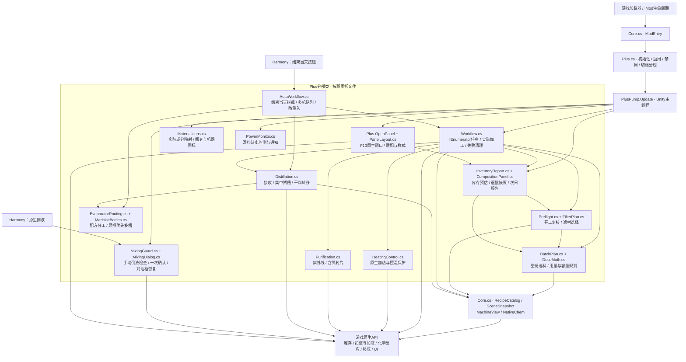
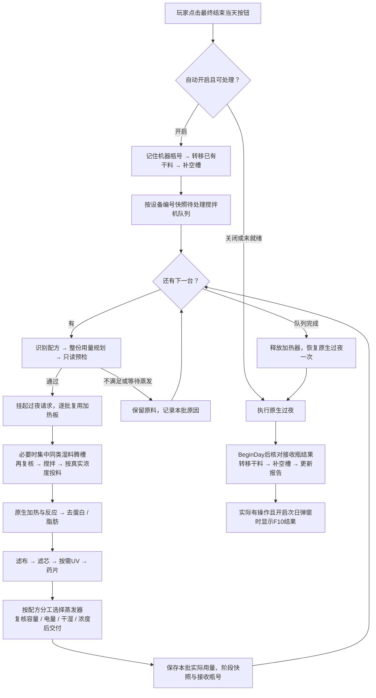

# 模块与状态边界

本文的运行时文件名均相对ChemAssistPlus/；操作脚本、辅助工具、研究资料与截图分别位于仓库根目录的scripts/、Tools/、Research/、Screenshots/。完整目录与构建入口见[仓库说明](REPOSITORY.md)。

## 架构总览（0.4.7）

下图按职责分组；箭头表示主要调用或数据依赖，并非独立服务。大多数业务文件都是同一个静态分部类Plus，共享当前存档的会话状态，由Unity主线程驱动。

## 结束当天的数据与控制流

图中为正常完成路径。重复结束当天请求由pendingEndDay/resumingEndDay防重入；执行异常或取消会停止任务、关火并保留物料，是否继续过夜由对应停止路径决定，不能按成功流程推断。预检失败只跳过该批，执行异常会停止队列。

状态分三类：任务、队列、来源偏好、逐批报告及待确认混液请求保存在当前会话，切档/禁用时清理；蒸发器配方与机器首选瓶号写入机器原生自定义标签，随游戏正常存档；液体、设备和库存始终使用游戏原生对象与操作。图标与面板负责展示，不生成材料。干料可转入制剂机，当前自动流程不按制剂按钮，成型由玩家操作。

## 执行路径

Unity 主线程 PlusPump → 最终结束当天按钮 → 按编号快照所有待处理搅拌机 → 当前批只读预检 → 暂缓原生过夜 → 首种原料按酒精库存及工作瓶容量选择完整份数 → BlendInto → 同比补溶剂 → 原生加热/反应 → 去蛋白/脂肪 → 滤布 → 滤芯 → 按需紫外线消毒 → 含氯药片 → 独立蒸发器原液槽 → 下一台重新预检并逐批复用加热器 → 队列结束恢复原生过夜一次。
产物留原工作瓶，馏出槽回收溶剂。放料白天不开工，无任务正常过夜；没有新料且蒸发器全占用时正常等待。

## 按问题定位

| 问题 | 文件 / 搜索入口 |
| --- | --- |
| 入口、配方、物品递归、按角色找槽位 | Core.cs；ProbeResult |
| 来源浓度/排序、真实投料、过滤、F10 | Plus.cs；Sources、TakeLiquid、SolventTargetForParts、FilterBatch |
| 完整份数、试剂/峰值预估 | BatchPlan.cs；PlanWholeMaterials、BuildBatchPlan；DoseMath.cs |
| 只读预检、去蛋白方向 | Preflight.cs；ProteinReagent |
| 实际执行、反应、耗料与进度 | Workflow.cs；Run；HeatingControl.cs |
| 滤材耐久排序、换装与归还 | FilterPlan.cs；Plus.cs 的 FilterBatch |
| 散片/瓶内片、真实耗片、净化下限 | Purification.cs；Tablets |
| 紫外线设备检查、原生消毒、结果与跳过原因 | Purification.cs；PurifyWithUV；Workflow.cs 的 Publish |
| 过夜拦截、防重入、无新料等待 | AutoWorkflow.cs；WaitingForDistillation、EndDayProcessingHook |
| 蒸发器接收、同类相近浓度合并、存量集中腾槽、干料移入制剂机、转液回收 | Distillation.cs；CanReceiveBatch、DeliverToEvaporator、PlanConsolidation、ConsolidateEvaporators、StageDryEvaporatorBottles、TransferWholeSolution |
| 原生手动倒液的配方／浓度／干湿混合确认 | MixingGuard.cs；BeforeLiquidTransfer、MixReason、ConfirmMix；PlusPump.TickMixConfirmation |
| 混液确认大字布局／滚动及原生样式恢复 | MixingDialog.cs；MixDialogView、MixRectState、RestoreMixDialogView |
| 容器居中纵排及机器本体左上横排原材料图标 | MaterialIcons.cs；MaterialMask、MaterialBounds、DrawMaterialIcons、RefreshMachineMaterials、TickMaterialIcons |
| 蒸发器配方记忆与固定分配 | EvaporatorRouting.cs；EvaporatorRoute、RememberOccupiedEvaporators、AcceptsEvaporatorRoute；Distillation.cs各接收/集中/空瓶路径 |
| 过夜恢复机器空容器／制剂机空瓶接料 | MachineBottles.cs；RememberMachineBottles、RefillMachineBottles、CanReceiveEmptyFinisher |
| 湿料缺电持续监测与小通知 | PowerMonitor.cs；Charged；InventoryReport.cs |
| 面板布局与预计/实际报告 | CompositionPanel.cs、PanelLayout.cs；450×720、按设备纵向行池、左侧名称及条内用量/库存或剂量/纯度、当前用量/本晚结果切换、固定底栏；缩放时重算文字高度 |
| 构建、扫描、查询、部署与打包 | DEVELOPMENT.md；Tools/NativeScan、Tools/AssemblyQuery |

## 状态与物料边界

- Plus 的 partial 文件共享当前存档会话状态；切档清任务、来源偏好、报告和挂起过夜。
- 0.4.7 MixingDialog仅在本模组已挂起的混液请求上临时设置共享GenericConfirmationUIManager：保存panel/body/两按钮的父级、同级序号和RectTransform、正文全部受影响文本样式；参照原生按钮字号固定正文（至少24号）和略大标题，并禁用自动缩字，按preferredHeight与画布尺寸布局。自建带遮罩的ScrollRect容纳长正文，按钮置底；pending请求关闭/替换/确认/取消后Tick恢复原生层级及样式，再销毁自建视口，切档/禁用立即清理。确认依旧只放行原有一次转液。
- 0.4.7 MaterialIcons.LiveLiquidAmount通过item.state.dict.TryGetValue只读CURRENT_PART值，避免GetTagReadonly读取滞后的modifiedState；不调用GetTag以免为缺失项创建标签。图标原生倒液Postfix及MovePot成功后失效，每帧比较现有成分掩码／机器工作瓶引用，0.25秒扫描补充新项；蒸发器实际配方学习共用LiveLiquidRecipe。几何位置仍沿用0.4.6已确认布局。
- 0.4.7 MachineBottles在BeforeEndDay完成预检任务队列前，记录三种目标机器当前瓶号到机器原生CHEMASSISTPLUS_PREFERRED_BOTTLE_V1标签；StageDry后及BeginDay的StageDry后补空槽。两遍分配：先原瓶号（仍须Owned/LooseBottle/原生与实际体积均为0/槽位允许），再容量降序、编号升序选散放空瓶。已有瓶子不换、不从别台机器拆瓶、回收槽不动；每次移动前重检，MovePot原生完成后记录日志和nightDetails。空接收制剂机纳入FindDryFinisher候选，源干料仍通过TransferWholeSolution转入；源空瓶留蒸发器，必要时设对应制剂配方。补瓶只在自动处理开启且不忙的日界执行，预检不补瓶。
- 蒸发器路线记忆由机器原生自定义字符串标签CHEMASSISTPLUS_EVAPORATOR_RECIPE_V1保存ProductId，随游戏原生序列化保存，不使用跨存档静态映射、不直接改磁盘存档。EvaporatorRoute读取当前可唯一识别的瓶内配方，若为空/不可识别则读标签；Poll每2秒只在实际单配方内容改变时写记忆，Deliver成功及StageDry移出前也保存。手动放置不同单配方原液视为重新分工，混液/空瓶不覆盖。CanReceiveBatch同时核对路线，FindEvaporator先同配方再未分配，仍核对电量/容量/浓度/干湿；PlanConsolidation新存IncomingRecipe，腾空源机须能接本配方，不再为不同配方腾槽；ParkSpareRawBottle也按路线过滤。预检与图标刷新仅读，空置已分配蒸发器横排显示记忆原料标识。
- MaterialIcons只读映射已证实的原材料来源，直接加载原生种植物图集，不实例化原料物品：咖啡浆/咖啡因→咖啡豆，梦帽菇浆/提取物/nomore→梦帽菇，梦魇帽菇浆/提取物→梦魇帽菇。每0.25秒只读扫描当前拥有物品更新成分掩码与机器container槽；容器和机器图标均挂在本体middle/fakeMiddle，逐帧同步background/fakeBackground显隐和透明度。MaterialBounds把background实际GetWorldCorners转成middle局部边界，并与祖先有效RectMask2D/Mask边界相交；容器在可见瓶图中心纵排，机器在可见机图左上横排，右上保留一个格大小（至多半宽）给状态模组。图标大小由可见宽高和数量约束，中心锚点配合localPosition避免槽位布局与全局gridSize不一致导致裁切。操作窗口中的容器同样覆盖；不再添加任何原料标题栏按钮。切档/禁用统一ClearMaterialIcons，不写液体/形状/存档标签。
- MixingGuard在WaterHelper.TransferLiquid真正扣液前拦截，按预计倒入份额和目标存量识别Recipe的FeedLiquids[0]/ProductLiquid，不把FeedLiquids[1]等溶剂作为配方。两侧均有加工成分时，不同配方、同配方原浆/提取物合计浓度差>5个百分点或原生WetTotal干湿状态不同才弹GenericConfirmationUIManager；确认前不取液/耗滤材，取消不调用原方法。授权只绑定本次两瓶、当前PlayerStore、父库存、全部液体快照和目标容量，确认时重新核对，成功仅放行一次原生TransferLiquid并刷新瓶音。窗口被替换/关闭、禁用、切档清除待确认引用；自动加工仍走原有严格同类规则。
- 开工前复核完整输入快照与 Selected；未选固体留输入格。预检不取片、不耗料。
- 只操作Container原液槽，回收槽保持原样。存量集中后源空瓶留原液槽；PlanConsolidation须检查其容量≥当前批次保守预计体积，下一批按已有空瓶路径接收。新批次合并后尝试将源空瓶放入其他空闲蒸发器原液槽备用，没有空槽则留原位。
- 自动处理开启且无工作流运行时，在BeforeEndDay清理旧报告后及BeginDay的ReportAfterOvernight中调用StageDryEvaporatorBottles。已提取且WetTotal≤DRY_TOLERANCE_UL的原液优先经CanMergeDryFinisher核对，整瓶并入已设同配方制剂机容器槽内的同类已提取干料，双方须干燥且容量足够；TransferWholeSolution执行原生转液，源空瓶留蒸发器原液槽备用。无合格合并目标时移瓶至空闲制剂机，优先匹配SELECTED_CHEM_ID_TAG，再空配方/其他配方，移动后设对应配方。不调用制剂按钮，失败记录瓶子实际位置。干料处理单独记nightDetails；合并后已有批次PotId/runPotId转向接收瓶，过夜阶段显示合计。
- 若当前批次无可用蒸发器，BatchPlan只读规划两台设备的同配方已提取湿存量集中，存量不限浓度差；集中目标容量、两台供电、腾空源瓶接收下一批的容量均须满足。Run完整预检通过后，PrepareBatch在搅拌前同步复核/转液，保留源空瓶，再重新预检；失败停止队列。只转移已有液体，不模拟蒸发，不混干料。共用TransferWholeSolution的原生扣除/累加/未转移组分回收；集中后重定向nightDetails接收瓶编号。
- pendingEndDay 保存原生请求，重入标记防止重复过夜；每32拍让帧，提取最多900拍。
- nightBlenders 每晚快照并且每台只访问一次；不重复处理限量余料。前批送入蒸发器并关闭/释放加热器后才启动下一批。不同配方不合液；已有接收瓶仅在同种已提取湿半成品、有效成分浓度差≤5个百分点、容量足够整批且有电时接收；空接收瓶可直接装液。优先接收瓶，次选空槽，干料/待提取原料不混入。预检保守检查预计体积与同类接收可能，最终按实际浓度/容量/供电复核。
- DeliverToEvaporator 同步原生RemoveAndReturn→AddSolution，不跨帧悬空；finally根据接收瓶实际增加量归还未转移成分。合并不换接收瓶，源空瓶优先放其他空闲蒸发器原液槽；runPotId转向实际接收瓶，净化前四阶段保留本批快照、过夜阶段显示接收瓶合计。预检失败继续下一台，执行异常/停止/切档清队列；nightBatchReports 汇总文字结果；nightDetails 独立保存每批阶段数组、实际试剂用量/开工库存、接收瓶编号及配方。过夜按各接收瓶分别补阶段快照，合并批次过夜量为接收瓶合计。previewDetails 每次只读刷新列出全部待处理搅拌机，失败原因仅归所属批次，不叠加旧失败横幅。
- 失败/取消通过 finally 关火、保液并恢复过夜；自动开关不因此关闭。
- 过滤按原生元数据与耐久分份，每份每道一次；已处理液体同步缓冲并 finally 回瓶，不跨帧悬空。
- nightDidWork 仅实际操作后为 true；仅实际工作且 Popup 开启才次日弹 F10。供电小通知独立，每日/状态去重。
- API 的签名、单位与副作用只在 NATIVE_API.md 维护。
